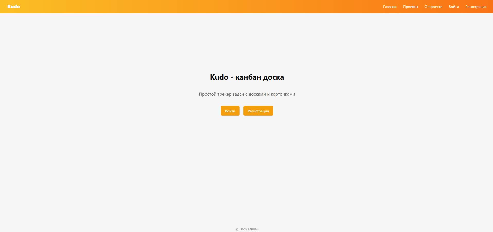
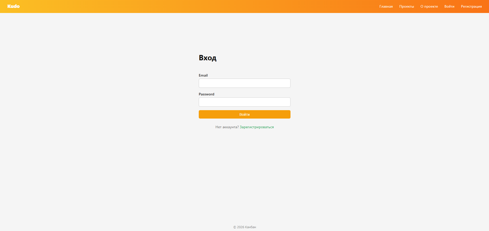
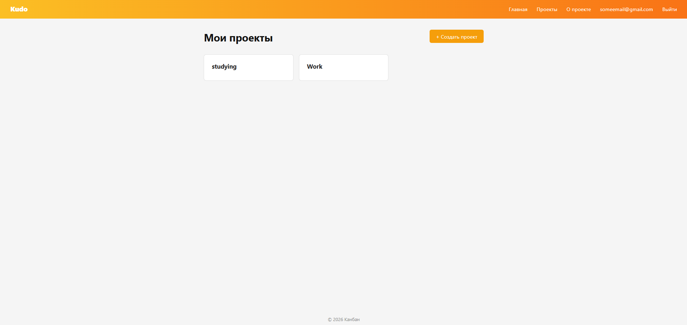
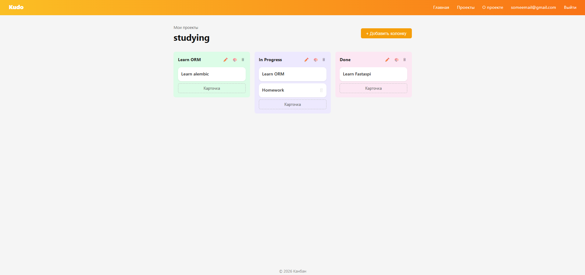

# Kudo
Kudo - is a website developed using the FastAPI framework for creating Kanban boards

## 📝 Description
Dynamic website built with FastAPI that serves as a mini-tracker. The project is split a separate backend (Python/FastAPI) and Fronted(HTML/CSS), with a PostgreSQL database.

## 💻 Functionality
* ***Multi-page structure:** Server-side routing has been implemented with FastAPI for the "Home", "Projects" and "About".
* **Jinja2 templating:** Uses a base template (`base.html`) and block inheritance to avoid duplicating the UI (header, navigation, footer).
* **Database & migrations:** SQLAlchemy ORM models with Alembic migrations for schema versioning.
* **Authentication** JWT-based auth (token validation) protecting the relevant endpoints.
* **Configuration isolation:** All build artifacts, the virtual environment (venv/), and configuration files (.env) are reliably excluded via .gitignore.

## 🧑🏻‍💻 Technologies

### Core
- **Python 3.10+**
- **fastapi 0.141.1**
- **uvicorn 0.54.0**

### 📊 Data storage
- **Postgre SQL**
- **SQLAlchemy**
- **Alembic**

### Interface
- **HTML5 / CSS**
- **Jinja2**

### Additionally
- **dotenv** - for storing secret data
- **pydantic** - for validation data

## ⏬ Download

1. Clone repository:

    ```bash
    git clone https://github.com/skrizzz-dev/hollow_knight_vlog.git
    ```
    
2. Create and activate virtual environment

   **Windows:**
   ```bash
   python -m venv venv
   venv\Scripts\activate
   ```

   **Linux/Mac:**
   ```bash
   python -m venv venv
   source venv/bin/activate
   ```
   
3. Download requirements:
   ```bash
   pip install -r requirements.txt
   ```
   
4. Run application:
   ```bash
   fastapi dev
   ```
      
## 📂 Structure of project

- `main.py` - main application file, server startup, and routing (routes).
- `schemas/` - pydantic schemas for request/response validation and serialization.
- `core/` - application core: settings, security (JWT), and database
- `models/` - SQLAlchemy ORM models (database tables).
- `alembic/` - database migrations
- `static/` - folder with static files for the website.
- `templates/` - HTML-templates Jinja2 (base template `base.html` and tab pages).
- `tests/` - pytest for testing (api, db)
- `.gitignore` - git exclusion file (venv, cashe, .env).
- `requirments.txt` - a list of the project's external dependencies.
- 
## 📷 Screenshots

## landing page


## auth_page


## main page


## project page


